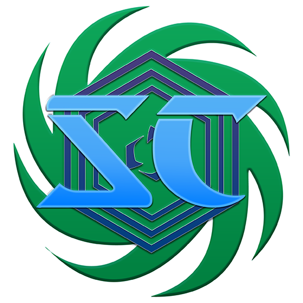

<div align="center">
  <a href="https://scnexus.net" target="_blank">
    
  </a>
  <h1>SCNexus</h1>
  <p>Nexus Application for the StarCraft Community</p>
  <p>
    <a href="./README.md">中文</a> | ENGLISH
  </p>
</div>

<div align="center">


</div>
<div align="center">

<a title="Crowdin" target="_blank" href="https://crowdin.com/project/scnexus"></a>
</div>

## SCNexus

To learn more about SCNexus Application, please visit the project's official website:

✈️ [Official Website](https://scnexus.net) | 📖 [User Guide](https://scnexus.net/guide/)

## Getting Started

### Windows

**Get the Application Installer**

- Download the Windows NSIS installer from the official website: [SCNexus](https://scnexus.net/)

**Get the Application from Microsoft Store**

The Microsoft Store version is not available, as the APPX package does not function correctly under the current sandbox.

<!-- <a href="https://apps.microsoft.com/store/detail/9PL7DCMCN13X?launch=true&mode=full">
	
</a> -->

**GitHub Releases**

This repository does not ship prebuilt installers. Automated builds and code signing are not ready yet, and released versions are distributed through the official website.

### Linux & macOS

Support is planned for the future, but the application currently lacks development and functional testing on these platforms.

### Building from Source

Development and building require Node.js 26 and pnpm 11 or later:

```bash
pnpm install
pnpm run dev      # development mode
pnpm run build    # type check and build the runtime packages
```

Packaging commands for Windows output, the isolated Electron smoke test and known limitations are documented in the [Build Guide](./docs/building.md).

## Features

- **Rich information display** — provides content creators with richer, more useful information for maps and mods.
- **Map and mod ratings & reviews** — planned.
- **Custom campaign distribution and management** — helps creators distribute custom campaigns and custom content, and gives players the ability to install and manage them. Supports the SCNexus Standard and the [CCM Package Standard](https://github.com/7thAce/SC2CCM).
- **Cloud bank sync** — planned. Provides cloud sync for banks of local native campaigns, local custom campaigns and arcade maps that have joined the Project Arcade Cloud Bank Service.

## Questions and Community

[GEECG] SCNexus Chinese User Community: 857601125

[GEECG] SCNexus Discord Server: https://discord.gg/U6EbQKdkH2

## Localization

Welcome to take part in the translation of SCNexus Application, to translate the application into more languages. Please read the [Contributing Guide](./CONTRIBUTING.english.md) first.

| Key | Language | Status              |
| --- | :------- | :------------------ |
| zh  | Chinese  | ✔️ Native Supported |
| en  | English  | ⏳ WIP              |

## Contributing

Thank you for your will to contribute. Please read the [Contributing Guide](./CONTRIBUTING.english.md) for more details. Before working on the codebase, please also review the [development conventions](./AGENTS.md) and the [architecture notes](./docs/architecture.md).

## Development Documentation

The `docs/` directory of this repository holds the application's development documentation, covering architecture, build instructions, package format and server integration. User-facing documentation is maintained in the [scnexus-docs](https://github.com/MengLuoRJ/scnexus-docs) repository and the [User Guide](https://scnexus.net/guide/).

## License

SCNexus is licensed under the [BSD 3-Clause License](./LICENSE).

Third-party components, binaries and assets redistributed with the application remain under their own licenses; see [Third-Party Notices](./THIRD-PARTY-NOTICES.md).

StarCraft II, Blizzard Entertainment and related names, logos and artwork are trademarks or registered trademarks of Blizzard Entertainment, Inc. SCNexus is an unofficial community project and is not affiliated with, endorsed by, or sponsored by Blizzard Entertainment, Inc.
